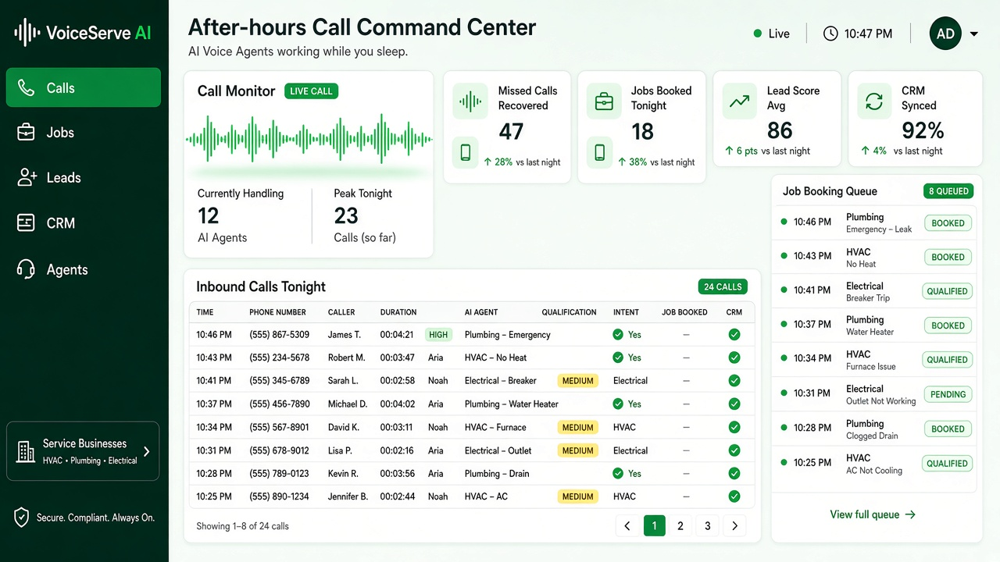

# AI Voice Agent for Service Businesses



**SEO description:** AI voice agent for service businesses that answers calls, books jobs, qualifies leads, and syncs CRM so owners never miss revenue after hours.

**Tagline:** Never miss after-hours revenue again  
**Industry:** HVAC / Plumbing / Electrical / Home Services  
**Accent:** `#16A34A`  
**Author:** [Imran Ahmed](https://imrandev.bd) (`me@imrandev.bd`)

---

## Why service owners choose this stack

Missed after-hours calls become missed jobs. Voicemail does not qualify urgency. Dispatch boards stay empty overnight. CRM never sees the lead. **VoiceServe AI** is a complete Laravel + Filament business platform that puts an AI voice agent on every line — answering, qualifying, booking, and syncing CRM — with **every module toggleable**.

### Ops time-saver ROI

| Manual after-hours process | Typical weekly hours / loss | With VoiceServe AI |
|---|---|---|
| Missed overnight & weekend calls | 8–20 lost jobs | AI answers every ring |
| Morning callback chase | 5–10 hrs | Jobs already booked |
| Manual lead scoring from notes | 4–8 hrs | Live qualification scores |
| Re-keying into Jobber / HubSpot | 4–7 hrs | CRM sync on hang-up |
| Emergency triage guesswork | High stress | After-hours rules + escalate |

A mid-size HVAC/plumbing shop often recovers **10–25 booked jobs per month** that used to die in voicemail. At average ticket value, that is frequently **$4,000–$15,000+/month** in recovered revenue — before counting happier customers who never hit a dead line.

---

## Features

- **AI Voice Agent** — answer, qualify, book, and sync with auditable agent runs
- **Voice Calls** — inbound/outbound log with after-hours flags, disposition, recordings
- **Leads** — caller profiles, service interest, score, owner assignment
- **Lead Qualification** — urgency, budget fit, service fit, decision-maker signals
- **Job Bookings** — windows, trade, address, tech notes, AI-booked flag
- **Call Transcripts** — searchable speaker turns with intent + sentiment
- **CRM Sync** — HubSpot, Jobber, ServiceTitan, Salesforce push status
- **Service Catalog** — SKUs the agent can quote and book (including after hours)
- **After-Hours Rules** — calendars, greetings, emergency booking, escalation phone
- **Module Control Plane** — enable/disable domains from config + Filament Modules
- **Multi-role users** — Super Admin, Admin, Manager, Staff, Client, Demo
- **Public marketing pages** — home, features, modules, pricing, demo
- **Dockerized** — `Dockerfile`, `docker-compose.yml`, nginx, MySQL, Redis
- **Packagist toolkit** — `imrandevbd/*` packages for AI hub, catalog, PDF, slug, speed, admin, attendance

---

## Modules (on/off)

| Module key | Default | Purpose |
|---|---|---|
| `voice_calls` | ON | Call log & dispositions |
| `leads` | ON | Caller / lead profiles |
| `lead_qualification` | ON | AI scoring from calls |
| `job_bookings` | ON | Schedule jobs from calls |
| `call_transcripts` | ON | Searchable transcripts |
| `crm_sync` | ON | CRM push tracking |
| `service_catalog` | ON | Bookable trades & SKUs |
| `after_hours` | ON | Hours, greetings, escalate |
| `voice_agent` | ON | AI agent orchestration |
| `attendance` | OFF | Optional staff time-clock hub |

Filament navigation hides disabled modules. Services refuse work when their module is off.

---

## Tech stack

- PHP 8.3+ / Laravel 13
- Filament 5 admin (`/admin`) — primary color `#16A34A`
- Livewire 3
- SQLite (local default) or MySQL (Docker)
- Packages:
  - `imrandevbd/drutogoti`
  - `imrandevbd/laravel-admin-panel`
  - `imrandevbd/laravel-ai-catalog`
  - `imrandevbd/laravel-ai-hub`
  - `imrandevbd/laravel-attendance-hub`
  - `imrandevbd/laravel-unicode-pdf`
  - `imrandevbd/laravel-universal-slug`

### Laravel 13 package bridges

Packagist builds that still pin `illuminate/*` to `^11|^12` are provided as **path repositories** under `packages/`:

- `packages/drutogoti`
- `packages/laravel-admin-panel`
- `packages/laravel-attendance-hub`
- `packages/laravel-ai-catalog`

These shims require `illuminate/support: ^11|^12|^13` so `composer install` succeeds on Laravel 13 while `composer.json` still declares all seven `imrandevbd/*` packages. `laravel-ai-hub`, `laravel-unicode-pdf`, and `laravel-universal-slug` install from Packagist when compatible.

---

## Quick start

```bash
composer install --no-scripts
cp .env.example .env
php artisan key:generate
touch database/database.sqlite
php artisan migrate --seed
php artisan filament:upgrade
php artisan serve
```

Admin: [http://localhost:8000/admin](http://localhost:8000/admin)  
Demo: `demo@voiceserve-ai.test` / `password`

### Docker

```bash
docker compose up -d --build
```

App nginx: `http://localhost:8080`

---

## Demo users

| Role | Email | Password |
|---|---|---|
| Super Admin | superadmin@voiceserve-ai.test | password |
| Admin | admin@voiceserve-ai.test | password |
| Manager | manager@voiceserve-ai.test | password |
| Staff | staff@voiceserve-ai.test | password |
| Client | client@voiceserve-ai.test | password |
| Demo | demo@voiceserve-ai.test | password |

---

## Opportunities

- White-label agent scripts per franchise brand
- Telephony provider adapters (Twilio / Telnyx / SIP)
- Multi-location after-hours calendars
- SMS confirmations after AI booking
- Attendance hub for dispatchers & field techs
- Unicode PDF job packets for techs on site

---

## 🤝 Let's Connect & Collaborate

I am open to Senior Remote Full-Stack Roles, AI Platform Architecture Contracts, and Enterprise Technical Advisory.

Timezone: UTC+6 (Dhaka / Rangpur, Bangladesh) — Flexible overlap with US, UK, and European business hours.

Delivery Mode: Async-ready, Slack, Discord, Jira, GitHub, and production-first accountability.

| Channel | Address / Handle | Quick Action |
|---|---|---|
| 🌐 Primary Portfolio | [imrandev.bd](https://imrandev.bd) | [Visit Site ↗](https://imrandev.bd) |
| 📦 Packagist Packages | [packagist.org/packages/imrandevbd/](https://packagist.org/packages/imrandevbd/) | [View Packages ↗](https://packagist.org/packages/imrandevbd/) |
| 💼 LinkedIn Profile | [linkedin.com/in/imranbru99](https://linkedin.com/in/imranbru99) | [Connect ↗](https://linkedin.com/in/imranbru99) |
| 🐙 GitHub Profile | [github.com/imranbru99](https://github.com/imranbru99) | [Follow ↗](https://github.com/imranbru99) |
| 💬 WhatsApp Direct | +880 1576-918420 | [Chat Now ↗](https://wa.me/8801576918420) |
| 📧 Direct Email | me@imrandev.bd | [Send Email ↗](mailto:me@imrandev.bd) |
| 🐦 X (Twitter) | [@imrandev_bd](https://x.com/imrandev_bd) | [Follow ↗](https://x.com/imrandev_bd) |
| 📺 YouTube Tech | [@ImranDevBD](https://youtube.com/@ImranDevBD) | [Subscribe ↗](https://youtube.com/@ImranDevBD) |
